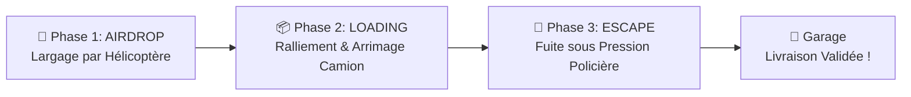

# 🚚🚨 Jeu Logistique & Poursuite Policière — Obstacle Avoidance

> **Projet M2 IA2 Casablanca — Intelligence Artificielle Réactive & Steering Behaviours (Craig Reynolds)**  
> Développé par **[yassine-580](https://github.com/yassine-580)**


---

## 📖 Présentation du Projet

Ce projet est un **jeu de stratégie et d'action tactique en temps réel** basé sur la physique des forces directrices (*Steering Behaviors*) théorisées par **Craig Reynolds**.

Il simule une chaîne logistique sous haute tension :
1. **Un hélicoptère** déploie des conteneurs de marchandises sensibles sur un héliport.
2. **Un camion (pilotable au clavier ou guidé par IA)** doit rallier la marchandise qui déambule au sol, l'arrimer solidement à son bord.
3. **La police d'élite** se met en traque immédiate avec calcul d'anticipation vectorielle dès que la cargaison est chargée.
4. Le camion doit traverser les réseaux routiers, slalomer entre les obstacles et barrages tactiques, pour **livrer la cargaison au Garage** en sécurité.

Le code source complet du jeu se trouve dans le dossier [`6-ObstacleAvoidance/`](file:///c:/Users/yassine/Desktop/police&Camion/6-ObstacleAvoidance/).

---

## 🎯 Les 3 Phases de Jeu d'une Mission



1. **Phase 1 — Largage Aérien (`AIRDROP`)** :
   - L'hélicoptère décolle et navigue vers l'héliport avec une force d'arrivée (`arrive`).
   - Phase stationnaire de survol (`hover_drop`) avec descente treuillée de la caisse (`CargoBox`).
   - L'hélicoptère repart une fois la caisse déposée.

2. **Phase 2 — Chargement (`LOADING`)** :
   - La cargaison au sol possède son propre comportement d'errance douce (`wander`).
   - Le camion le plus proche (joueur ou allié) calcule sa trajectoire d'approche et s'arrime au contact.

3. **Phase 3 — La Fuite sous Pression Policière (`ESCAPE`)** :
   - Déclenchement de l'alarme sonore de fuite.
   - Les véhicules de police identifient en priorité absolue le camion transporteur (`targetPriority`).
   - Les barrages routiers et obstacles doivent être évités tout en maintenant la vitesse jusqu'au garage.

---

## 🏆 Les 5 Niveaux de Jeu

| Niveau | Titre & Thématique | Spécificités & Difficulté | Objectif |
| :---: | :--- | :--- | :---: |
| **Niv. 1** | **Introduction & Sécurité** | Route ouverte simple, 1 camion, 1 police lente, aucun barrage. | 1 livraison |
| **Niv. 2** | **Obstacles & Pression** | Circuit routier fermé en boucle, police plus agressive, temps de réaction réduit. | 1 livraison |
| **Niv. 3** | **Complexité Tactique** | Déploiement de **barrages routiers destructibles** (`Roadblock`), 2 camions en circulation. | 2 livraisons |
| **Niv. 4** | **Urgence Maximale** | **2 voitures de police d'élite** avec forte anticipation vectorielle prédictive. | 2 livraisons |
| **Niv. 5** | **Le Grand Défi Final** | **Tempête de pluie dynamique**, visibilité réduite, **3 intercepteurs de police** coordonnés. | 3 livraisons |

---

## 🚨 Écran de Game Over Intelligent

Lorsque tous les camions sont interceptés par la police, un écran de Game Over dynamique et immersif s'affiche et offre un **double choix au joueur** :

- **`🔁 REJOUER CE NIVEAU (NIV. X)`** :
  - *Raccourci* : <kbd>ENTRÉE</kbd> ou <kbd>ESPACE</kbd> ou clic sur le bouton vert.
  - Conserve la progression et relance le niveau actuel pour une nouvelle tentative.
- **`⏮️ RECOMMENCER AU NIVEAU 1`** :
  - *Raccourci* : <kbd>R</kbd> ou <kbd>1</kbd> ou clic sur le bouton gris.
  - Remet les scores et statistiques à zéro et redémarre la campagne depuis le début.

---

## 🧠 Comportements de Direction (Steering Behaviors)

Toutes les entités mobiles dérivent de la classe de base `Vehicle` :

| Comportement | Formule & Rôle | Entités utilisatrices |
| :--- | :--- | :--- |
| **Seek (Poursuite)** | $\vec{F}_{seek} = \vec{V}_{souhaitée} - \vec{V}_{actuelle}$ | Camions vers cible, Hélicoptère |
| **Flee (Fuite)** | Direction opposée à la menace dans un rayon paramétrable | Camions évitant la Police |
| **Arrive (Freinage progressif)** | Vitesse proportionnelle à la distance sous le rayon d'arrivée | Hélicoptère sur Helipad, Camions au Garage |
| **Wander (Errance)** | Projection d'un cercle d'errance avec déplacement angulaire aléatoire | Cargaison libre au sol |
| **Obstacle Avoidance** | Boîte de collision englobante projetée en avant + force répulsive orthogonale | Tous les véhicules (Camions & Police) |
| **Path Following** | Suivi fluide de checkpoints séquentiels avec seuil de tolérance | Camions et patrouille de Police |
| **Poursuite Prédictive** | Cible $\vec{T}_{futur} = \vec{Pos}_{camion} + \vec{Vel}_{camion} \times t_{anticipation}$ | Véhicules de Police |

---

## 🎮 Commandes & Raccourcis Clavier

| Raccourci | Action |
| :--- | :--- |
| <kbd>Z</kbd> <kbd>Q</kbd> <kbd>S</kbd> <kbd>D</kbd> ou <kbd>Flèches</kbd> | Conduire manuellement le Camion Joueur |
| <kbd>J</kbd> | Basculer le Camion Joueur entre **Manuel (ZQSD)** et **Automatique (IA)** |
| <kbd>U</kbd> | Masquer / Afficher le grand panneau HUD supérieur |
| <kbd>Tab</kbd> ou <kbd>T</kbd> | Ouvrir / Fermer le tiroir de réglages physiques (vitesses, forces, etc.) |
| <kbd>L</kbd> | Changer de niveau (cycle 1 à 5) |
| <kbd>H</kbd> | Déclencher un largage hélicoptère immédiat |
| <kbd>S</kbd> | Changer la cible des camions (Réseau routier vs Curseur Souris) |
| <kbd>Clic gauche vide</kbd> | Ajouter un obstacle personnalisé sur le terrain |
| <kbd>Clic droit sur obstacle</kbd> | Supprimer l'obstacle ciblé |
| <kbd>X</kbd> / <kbd>Suppr</kbd> | Supprimer le dernier obstacle posé |
| <kbd>Shift</kbd> + <kbd>X</kbd> | Vider tous les obstacles |
| <kbd>C</kbd> | Spawner un camion allié supplémentaire |
| <kbd>P</kbd> | Spawner une voiture de police supplémentaire |
| <kbd>M</kbd> | Couper / Réactiver le son |
| <kbd>D</kbd> | Activer / Désactiver l'affichage de débogage vectoriel |
| <kbd>R</kbd> | Réinitialiser la partie au Niveau 1 |

---

## 🏗️ Architecture du Projet

```text
police&Camion/
├── 6-ObstacleAvoidance/
│   ├── index.html               # Page principale avec HUD et canvas plein écran
│   ├── style.css                # Styles CSS modernes (glassmorphism, panneaux, sliders)
│   ├── sketch.js                # Boucle principale p5.js, phases, niveaux et Game Over
│   ├── vehicle.js               # Classe de base Vehicle (Euler, steering, limites)
│   ├── Camion.js                # Camion allié (path following, fuite police, chargement)
│   ├── PlayerCamion.js          # Camion du joueur (contrôles ZQSD ou pilotage IA)
│   ├── Police.js                # Véhicule de police (interception intelligente & patrouille)
│   ├── Helicopter.js            # Hélicoptère autonome (approche, hover, largage treuil)
│   ├── Helipad.js               # Zone d'atterrissage et d'ancrage du largage
│   ├── CargoBox.js              # Marchandise mobile (altitude, wander, arrimage)
│   ├── RoadNetwork.js           # Réseau routier procédural (Niveaux 1 à 5, ouverts/boucles)
│   ├── Roadblock.js             # Barrages policiers destructibles infligeant des dégâts
│   ├── Garage.js                # Bâtiment de dépôt et validation des livraisons
│   ├── obstacle.js              # Obstacles circulaires sur la carte
│   ├── SoundEffects.js          # Moteur audio synthétisé Web Audio API (aucun asset externe)
│   ├── libraries/               # Librairies externes (p5.min.js, p5.sound.min.js)
│   └── tests/
│       └── obstacleAvoidance.test.mjs  # Suite de 39 tests unitaires automatisés
├── README.md                    # Documentation complète
└── .gitignore                   # Fichiers ignorés par git
```

---

## 🧪 Tests Automatisés

Le projet comprend une suite complète de **39 tests unitaires** testant toutes les mécaniques :

```bash
cd 6-ObstacleAvoidance
node --test tests/obstacleAvoidance.test.mjs
```

---

## 🚀 Lancement Local

### Méthode 1 — Extension VS Code Live Server (Recommandé)
1. Ouvrez le dossier dans VS Code.
2. Faites un clic droit sur `6-ObstacleAvoidance/index.html` > **"Open with Live Server"**.

### Méthode 2 — Serveur HTTP Python
```bash
cd 6-ObstacleAvoidance
python -m http.server 8000
```
Puis accédez à `http://localhost:8000`

---

## 🌐 Déploiement sur GitHub Pages

Pour héberger et jouer à votre jeu directement depuis votre compte GitHub :

1. Poussez le projet sur GitHub :
   ```bash
   git init
   git add .
   git commit -m "Initial commit: Jeu Police & Camion avec Steering Behaviours et 5 Niveaux"
   git branch -M main
   git remote add origin https://github.com/yassine-580/VOTRE_DEPOT.git
   git push -u origin main
   ```
2. Sur GitHub, allez dans les **Settings** de votre dépôt > **Pages**.
3. Sous **Branch**, sélectionnez `main` (ou dossier `/docs`) et cliquez sur **Save**.
4. Votre jeu sera accessible en ligne sur :  
   `https://yassine-580.github.io/VOTRE_DEPOT/`

---

## 👨‍💻 Auteur

- **Yassine** ([@yassine-580](https://github.com/yassine-580))
- Formation : **Master 2 IA2 — Intelligence Artificielle & Applications**, Casablanca.
- Cours : *IAs Réactives & Steering Behaviours* (Michel Buffa).
